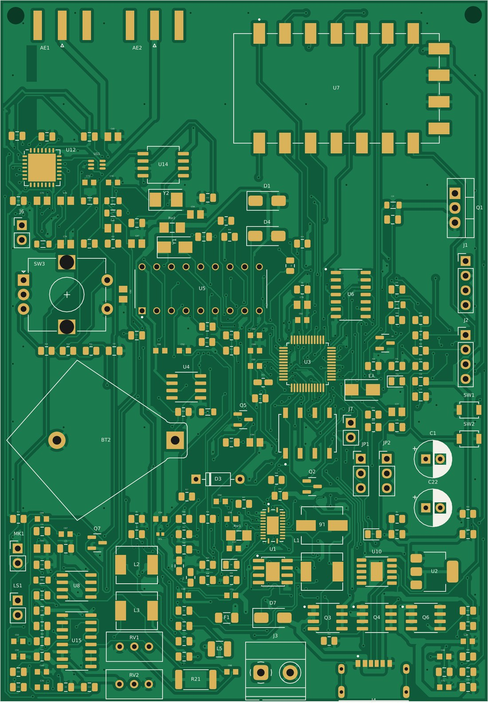
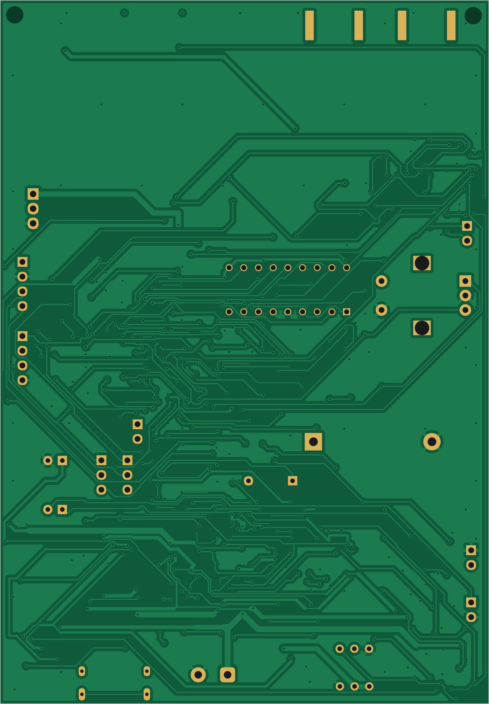
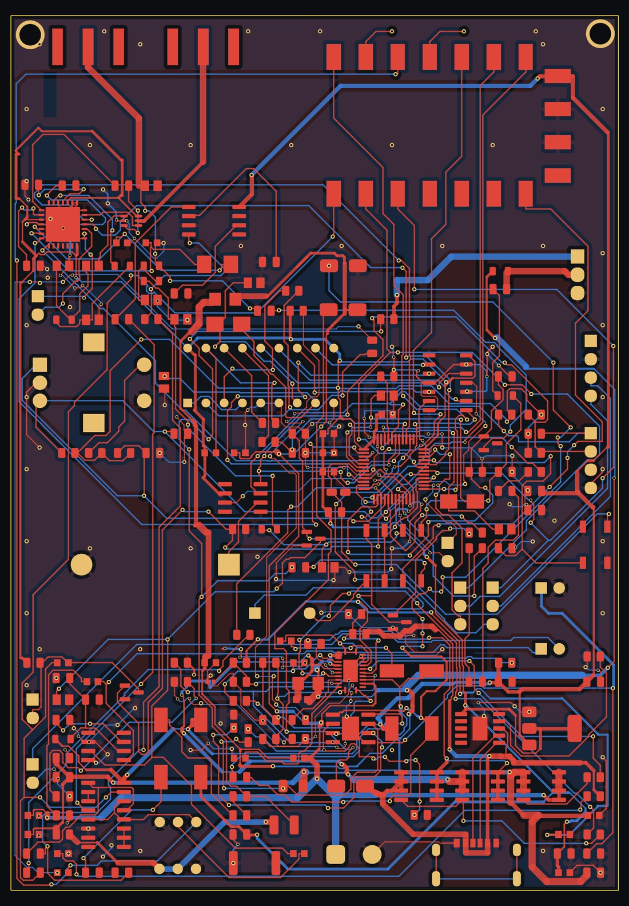
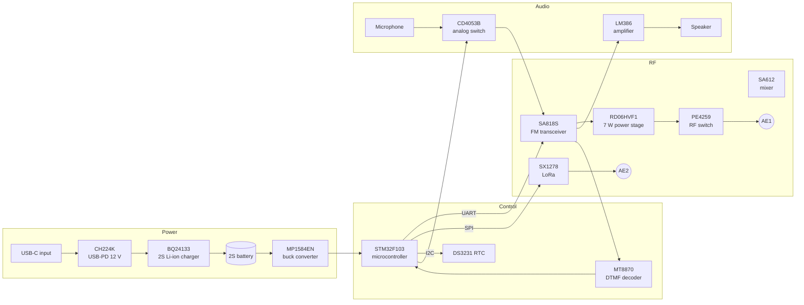

# Walkie-Talkie Radio Board

A handheld multi-mode radio on a single PCB: an FM voice transceiver with a 7 W RF power stage, a LoRa data link, DTMF signalling, a real-time clock, and a USB-C PD charged 2-cell Li-ion power system, all controlled by an STM32 microcontroller.

**Designer:** Abdelrahman Said, Mechatronics Engineering, Universiti Teknologi Malaysia (UTM)
**Status:** Layout complete and DRC-clean for fabrication. Prototype fabrication and staged bring-up are next.

| Board size | Stack-up | Components | Nets | Vias | Track segments |
|---|---|---|---|---|---|
| 84.5 × 121.5 mm | 2-layer FR-4, 1 oz | ~190 | 178+ | 532 (0.3 mm drill) | 3,661 |

---

## Board

<table>
<tr>
<td width="50%"> <b>Top side</b>: solder mask, ENIG pads and silkscreen</td>
<td width="50%"> <b>Bottom side</b>: mirrored, as seen from below</td>
</tr>
<tr>
<td width="50%"> <b>Copper layers</b>: top copper in red, bottom copper in blue</td>
<td width="50%"> <b>Detail</b>: STM32F103 (LQFP-48) fan-out on both layers</td>
</tr>
</table>

**Floorplan**

- **Top edge:** antenna feeds (AE1, AE2) and the SA818S radio module (U7), kept away from the switching regulator.
- **Centre:** STM32F103 (U3), DTMF decoder, analog audio switch and RTC.
- **Lower half:** power path: USB-C PD input (J4), charger (U1), buck converter, MOSFET switches and battery connector (J3).
- **Left edge:** microphone, speaker and audio amplifier, plus the coin-cell holder (BT2).

---

## Architecture

| Block | Part | Role on this board |
|---|---|---|
| Power | `CH224K` | Requests 12 V from a USB-C PD charger (single resistor on CFG1). |
| Power | `BQ24133` | Switch-mode charger for the 2-cell Li-ion pack, with current sensing. |
| Power | `MP1584EN` | Buck converter for the logic rails; enable divider and frequency resistor set per datasheet. |
| Control | `STM32F103` | Main controller: radio configuration, audio routing, user inputs. |
| Control | `DS3231` | Temperature-compensated real-time clock with coin-cell backup. |
| Control | `MT8870` | Decodes DTMF tones received over the voice channel. |
| RF | `SA818S` | FM voice transceiver module. |
| RF | `RD06HVF1` | RF power MOSFET stage for a 7 W output target. |
| RF | `PE4259` | RF switch on the antenna path. |
| RF | `SX1278` | LoRa link for long-range, low-rate data. |
| RF | `SA612` | Double-balanced mixer and oscillator stage. |
| Audio | `CD4053B` | Analog switch routing the microphone and audio paths. |
| Audio | `LM386` | Speaker amplifier. |

---

## From first layout to fabrication-ready

| Metric | Before | After |
|---|---|---|
| Fabrication-blocking DRC errors | 461 | **0** |
| Buck converter switching-node length | 161 mm | **45 mm** |
| Minimum via drill | 0.1–0.2 mm | **0.3 mm** (standard process, no surcharge) |
| Power nets widened for current | – | **10** |

**Design review and fixes**

- **Regulator enable pin over its rating.** The MP1584EN EN pin was tied directly to the input rail, above its 6 V absolute maximum. Replaced with a resistor divider (R51–R53) and added the missing frequency-setting resistor.
- **Floating inputs.** Seven pull-up resistors were not connected to any rail and one CD4053B select input was floating. All were tied to defined logic levels.
- **Symbol/footprint pin mismatch.** The SS34 symbol used A/C pin names while the footprint used pads 1/2, so every schematic-to-PCB update silently disconnected the diodes. Fixed the mapping and re-verified both diodes net by net.
- **Switching-node loop.** Swapped the positions of two power diodes (D1, D7) to cut the switching node from 161 mm to 45 mm and reduce radiated noise.
- **Placement against real copper.** New parts were placed only where they cleared all existing copper, not just component courtyards; every key net was checked for single-island connectivity.
- **Checked against datasheets.** Several suspected "errors" from an external review were verified as correct design choices and kept (for example, the charger CELL pin is left floating on purpose for 2-cell operation).
- **Fabrication package.** Gerber and drill files generated and checked against the board geometry. 1 oz copper selected because 2 oz requires wider track/space than the 0.15 mm signal routing; tented vias.

---

## Bring-up plan

1. **Bare-board checks:** visual inspection and resistance of every rail to ground before power.
2. **Power path:** current-limited bench supply, then USB-C PD negotiation, charger and buck output.
3. **Microcontroller:** SWD programming, clock, RTC and I2C/SPI/UART bus checks.
4. **Audio:** microphone path, analog switching, speaker amplifier and DTMF decoding.
5. **RF at low power:** SA818S and LoRa into a dummy load before any antenna.
6. **Power amplifier:** RD06HVF1 stage brought up gradually with current and thermal monitoring.

## Revision B: four-layer redesign

The current 2-layer board is about one third populated. Revision B targets roughly **65 × 90 mm** on four layers, with a solid ground plane on layer 2, a tighter regulator loop, and better isolation between the RF stage and the switching supply.

## Tools

KiCad · Freerouting · DRC and connectivity verification · JLCPCB DFM rules

---

**Contact:** Abdelrahman Said · saadoun.wdw@gmail.com
